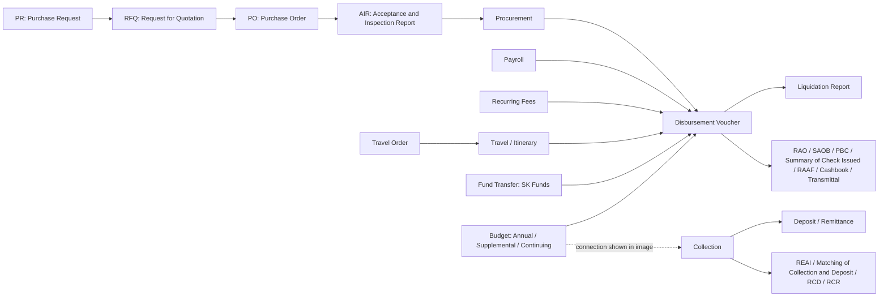
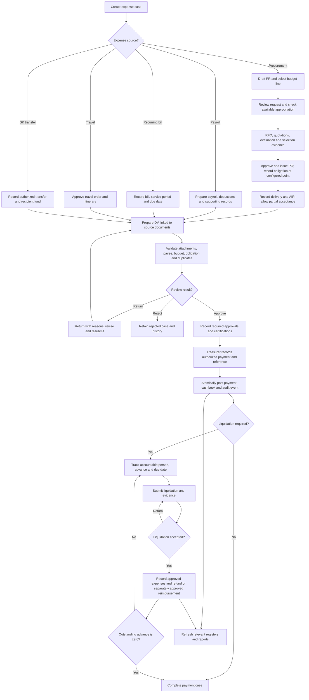
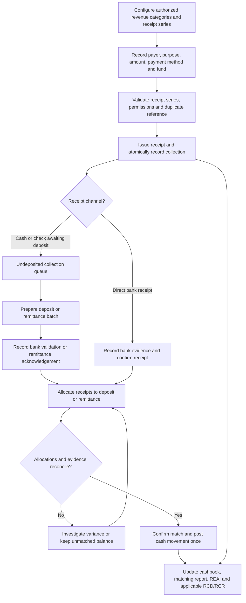
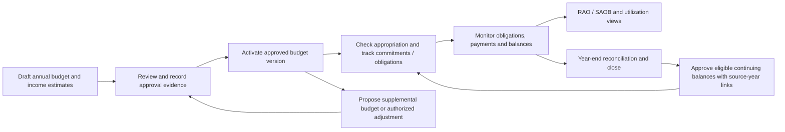

# Barangay Financial Management System by ODC — Process Flow

## 1. Reading of the supplied image

The image describes a financial management system with spending and revenue workflows, supported by a budget module and financial reports.

| Area             | Flow or content visible in the image                                                                                                                    |
| ---------------- | ------------------------------------------------------------------------------------------------------------------------------------------------------- |
| Procurement      | PR (Purchase Request) → RFQ (Request for Quotation) → PO (Purchase Order) → AIR (Acceptance and Inspection Report) → Procurement → Disbursement Voucher |
| Payroll          | Payroll → Disbursement Voucher                                                                                                                          |
| Recurring fees   | Electricity, water, internet, and similar fees → Disbursement Voucher                                                                                   |
| Travel           | Travel Order → Travel / Travel Itinerary → Disbursement Voucher                                                                                         |
| Fund transfer    | Fund Transfer (SK Funds) → Disbursement Voucher                                                                                                         |
| Budget           | Annual, supplemental, and continuing budgets; connections to disbursement and collection areas                                                          |
| Liquidation      | Disbursement Voucher → Liquidation Report                                                                                                               |
| Spending reports | RAO, SAOB, PBC, Summary of Check Issued, RAAF, Cashbook, and Transmittal                                                                                |
| Revenue          | Collection → Deposit/Remittance                                                                                                                         |
| Revenue reports  | REAI, Matching of Collection and Deposit, RCD, and RCR                                                                                                  |

The diagram below retains the image's labels. The multiple expense sources are interpreted as inputs to the same voucher workflow. The photograph does not specify approval roles, posting rules, or the exact meaning of every connection.

### Interpretation decisions for implementation

1. **Budget and cash are separate.** The budget connection to collection will represent estimated versus actual income. Approving a budget will not create a receipt, deposit, or cash balance.
2. **Procurement is one linked document chain.** The Procurement box becomes the case containing PR, RFQ, quotations, award/selection evidence, PO, deliveries, and AIR; users will not re-enter the AIR.
3. **Liquidation is conditional.** The image draws an arrow from DV to liquidation. The proposed system applies liquidation to cash advances and other transactions requiring it. A fully documented supplier payment will not automatically require a second liquidation workflow.
4. **Reports are derived views.** Their position in the image does not mean every report is generated solely from a voucher. RAO/SAOB need budget and obligation records; RAAF needs accountable-form movements; the cashbook needs receipts, payments, deposits, and transfers.
5. **The workflow is not a procurement policy specification.** Applicable procurement methods, thresholds, approvals, and documentary requirements must be confirmed before operational use. The RFQ chain is the flow supplied in the image, not a universal rule for every purchase.
6. **Keep uncertain abbreviations unchanged.** PBC and the prescribed titles/layouts of RAO, SAOB, RAAF, REAI, RCD, and RCR require the barangay's approved templates. Do not guess their definitions or signatories in code.

## 2. Proposed spending flow

The following adds application controls to the supplied process. Budget reservation and formal obligation are separate events, with the obligation point confirmed by the responsible finance personnel for each transaction type.

Cash advance liquidation recognizes how an existing advance was used. It must not create a duplicate payment or a second expense for the same underlying amount. A refund is linked to the advance and recorded according to the approved accounting treatment.

## 3. Proposed collection and deposit flow

Depositing previously collected money moves it from cash on hand to bank; it is not additional revenue. Matching a direct bank receipt must not post its cash movement twice. One deposit may cover several receipts. Allocation records also support partial deposits, with the remaining amount shown as outstanding.

## 4. Budget lifecycle

For the proposed commitment model:

`available to commit = approved appropriation + authorized net adjustments − outstanding reservations − net obligations`

A reservation is released or converted when an obligation is created, preventing double counting. Payments settle obligations and affect cash; they do not restore spending authority. Cancellation and reversal use explicit, authorized movements. Continuing balances are linked to their original authorization and must not be duplicated in a new annual budget.

## 5. Transaction states and exceptions

Use separate document, payment, and liquidation states rather than one overloaded status field.

| Record                    | Proposed states                                                                              |
| ------------------------- | -------------------------------------------------------------------------------------------- |
| Request or voucher        | Draft → Submitted → Under review → Approved; branches: Returned → Draft, Rejected, Cancelled |
| Approved record amendment | Create new revision → Resubmit → Reapprove; previous version remains visible                 |
| Payment                   | Unpaid → Partially paid → Paid; reversal is a linked corrective transaction                  |
| Delivery                  | Awaiting delivery → Partially accepted → Fully accepted; rejected quantities remain recorded |
| Cash advance              | Open → Partially liquidated → Liquidated; overdue is a calculated flag                       |
| Liquidation document      | Draft → Submitted → Under review → Approved or Returned                                      |
| Collection                | Draft → Issued → Voided through an authorized correction                                     |
| Deposit/remittance        | Draft → Submitted → Confirmed; linked reversal for corrections                               |
| Matching                  | Unmatched → Partially matched → Matched; variance requires resolution                        |
| Reporting period          | Open → Review → Closed; reopening requires authorization and an audit reason                 |

Failed saves retain the user's draft and show a retryable message. Duplicate submissions reuse an idempotency key. Simultaneous edits use a record version check. Returning a record requires a reason; changing approved financial fields invalidates the affected approvals. Posted records cannot be silently edited or deleted.

## 6. Reporting dependencies

| Output from the image              | Required source records / confirmation                                                                                            |
| ---------------------------------- | --------------------------------------------------------------------------------------------------------------------------------- |
| RAO / SAOB                         | Approved appropriations, adjustments, formal obligations, cancellations; confirm titles, formulas, and reporting cutoffs          |
| PBC                                | Confirm full title, required fields, triggering transaction, and signatories before implementation                                |
| Summary of Check Issued            | Issued checks, payees, vouchers, amounts, dates, cancellations and replacements; confirm prescribed title                         |
| RAAF                               | Accountable-form stock received, assigned, issued, voided, returned and remaining, including serial ranges                        |
| Cashbook                           | Opening balances plus posted cash/bank receipts, payments, deposits, remittances and transfers                                    |
| Transmittal                        | Selected finalized vouchers, reports and attachments with recipient, manifest and acknowledgement                                 |
| REAI                               | Approved income estimates and actual recognized collections by revenue category                                                   |
| Matching of Collection and Deposit | Receipt-to-deposit allocations, outstanding amounts, evidence, and variances                                                      |
| RCD / RCR                          | Collections and applicable deposits/remittances, receipt details, collectors and reporting period; confirm when each form applies |
| Liquidation Report                 | Advance, accountable person, accepted expense lines, supporting evidence, refunds and remaining balance                           |

Before official forms are finalized, finance stakeholders must approve sample inputs, expected totals, layouts, and signatory blocks. These diagrams are a proposed software workflow based on the supplied image; they do not certify regulatory compliance.
