# BFMS — role-based system flowcharts

These charts describe the checked-out application reviewed on 31 October 2026. Each box identifies the responsible role; its final line identifies who saves or which screen to use. SA means Super admin. Office checks and evidence handoffs use your established process; they are not automatic workflow tasks or additional approval screens.

Open the [illustrated handbook](user-flow-and-role-guide.html#flow-system) or [PDF](user-flow-and-role-guide.pdf) for the fixed-layout, printable charts. The SVG files below stay sharp when enlarged and link to the role playbooks. This source also includes Mermaid diagrams for editing and repository previews.

Live permissions: Super admin creates/submits financial records, posts receipts/matching and settles advances. An assigned Approver can approve/reject submitted DVs; an assigned Treasurer can record payments. Other staff check and coordinate within their permitted pages. Ordinary self-approval is blocked. These charts do not add permissions or certify official procedures.

## The whole system: roles, actions and handoffs.

Start at 1. Complete setup, follow the spending or collection branch, then reconcile the resulting records. Each box names the responsible role and who saves in the current live app.

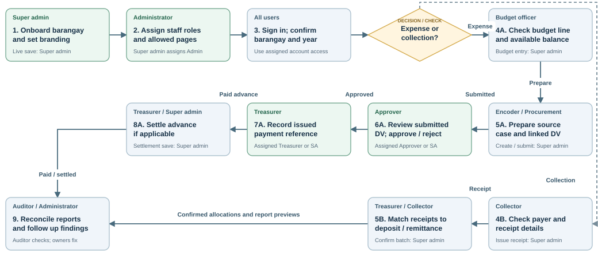

- The named staff role checks and coordinates its work; the save line identifies who can perform the current live action. SA means Super admin.
- Rejected DVs return to the preparer for a corrected new case. Detailed charts below show rejection, budget shortfalls, partial matching and advance balances.

Editable Mermaid flowchart

```mermaid
flowchart LR
  s1["Super admin<br/>1. Onboard barangay<br/>and set branding<br/>Live save: Super admin"]:::live
  s2["Administrator<br/>2. Assign staff roles<br/>and allowed pages<br/>Super admin assigns Admin"]:::live
  s3["All users<br/>3. Sign in; confirm<br/>barangay and year<br/>Use assigned account access"]:::check
  s4{"Decision / check<br/>Expense or<br/>collection?<br/>Choose the record path"}:::decision
  s5["Budget officer<br/>4A. Check budget line<br/>and available balance<br/>Budget entry: Super admin"]:::check
  s6["Encoder / Procurement<br/>5A. Prepare source<br/>case and linked DV<br/>Create / submit: Super admin"]:::check
  s7["Approver<br/>6A. Review submitted<br/>DV; approve / reject<br/>Assigned Approver or SA"]:::live
  s8["Treasurer<br/>7A. Record issued<br/>payment reference<br/>Assigned Treasurer or SA"]:::live
  s9["Treasurer / Super admin<br/>8A. Settle advance<br/>if applicable<br/>Settlement save: Super admin"]:::check
  s10["Collector<br/>4B. Check payer and<br/>receipt details<br/>Issue receipt: Super admin"]:::check
  s11["Treasurer / Collector<br/>5B. Match receipts to<br/>deposit / remittance<br/>Confirm batch: Super admin"]:::check
  s12["Auditor / Administrator<br/>9. Reconcile reports<br/>and follow up findings<br/>Auditor checks; owners fix"]:::check
  s1 --> s2
  s2 --> s3
  s3 --> s4
  s4 -->|"Expense"| s5
  s5 -->|"Prepare"| s6
  s6 -->|"Submitted"| s7
  s7 -->|"Approved"| s8
  s8 -->|"Paid advance"| s9
  s9 -->|"Paid / settled"| s12
  s4 -.->|"Collection"| s10
  s10 -->|"Receipt"| s11
  s11 -->|"Confirmed allocations and report previews"| s12
  classDef live fill:#ecf7f1,stroke:#6ea48c,color:#173147
  classDef check fill:#f0f5fa,stroke:#a7bdcb,color:#173147
  classDef decision fill:#fff5df,stroke:#d5ab4e,color:#173147
```

## Setup and access: put the right people in the right barangay.

Follow the account setup sequence before any financial work. A barangay sign-in link identifies the workspace; saved membership and page choices determine access.

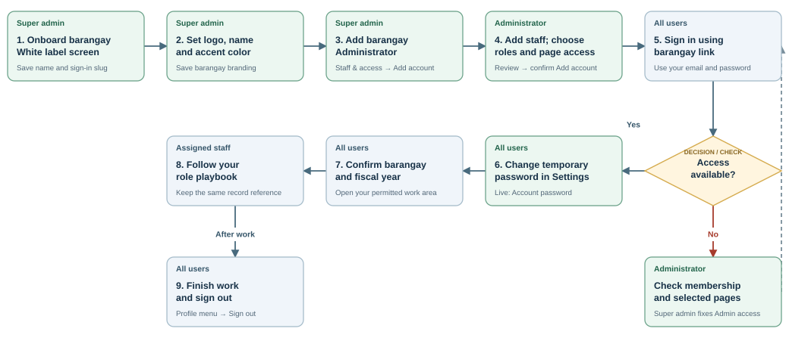

- Custom page selections replace the account’s role defaults for the selected barangay. Settings remains available when no financial pages are selected.
- An Administrator can manage staff; only a Super admin manages Administrator roles or White label. A role’s page access does not add financial posting authority.

Editable Mermaid flowchart

```mermaid
flowchart LR
  a1["Super admin<br/>1. Onboard barangay<br/>White label screen<br/>Save name and sign-in slug"]:::live
  a2["Super admin<br/>2. Set logo, name<br/>and accent color<br/>Save barangay branding"]:::live
  a3["Super admin<br/>3. Add barangay<br/>Administrator<br/>Staff & access → Add account"]:::live
  a4["Administrator<br/>4. Add staff; choose<br/>roles and page access<br/>Review → confirm Add account"]:::live
  a5["All users<br/>5. Sign in using<br/>barangay link<br/>Use your email and password"]:::check
  a6{"Decision / check<br/>Access<br/>available?<br/>Account / page check"}:::decision
  a7["All users<br/>6. Change temporary<br/>password in Settings<br/>Live: Account password"]:::live
  a8["All users<br/>7. Confirm barangay<br/>and fiscal year<br/>Open your permitted work area"]:::check
  a9["Assigned staff<br/>8. Follow your<br/>role playbook<br/>Keep the same record reference"]:::check
  a10["Administrator<br/>Check membership<br/>and selected pages<br/>Super admin fixes Admin access"]:::live
  a11["All users<br/>9. Finish work<br/>and sign out<br/>Profile menu → Sign out"]:::check
  a1 --> a2
  a2 --> a3
  a3 --> a4
  a4 --> a5
  a5 --> a6
  a6 -->|"Yes"| a7
  a7 --> a8
  a8 --> a9
  a9 -->|"After work"| a11
  a6 -->|"No"| a10
  a10 -.-> a5
  classDef live fill:#ecf7f1,stroke:#6ea48c,color:#173147
  classDef check fill:#f0f5fa,stroke:#a7bdcb,color:#173147
  classDef decision fill:#fff5df,stroke:#d5ab4e,color:#173147
```

## Spending: from request to approval and recorded payment.

All five expense sources converge on a linked disbursement voucher (DV). Follow the decision labels before passing the same case and voucher references to the next role.

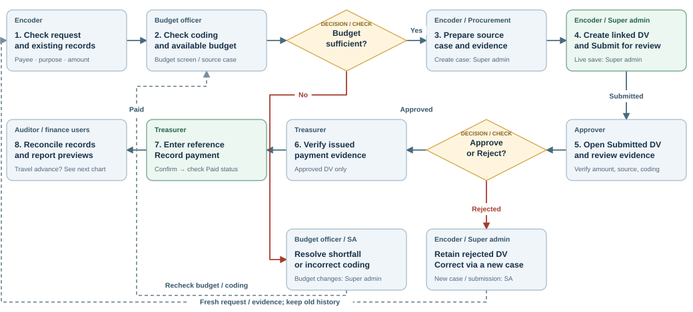

- Sources: Procurement (PR → RFQ → Purchase Order → AIR), Payroll, Recurring fees, Travel or SK transfer. Non-procurement cases start Ready for DV.
- Assigned Approvers can approve/reject; assigned Treasurers can record payment. Ordinary self-approval is blocked. The app has no Return/edit/resubmit path for a rejected DV; payment records the full amount and does not send money.

Editable Mermaid flowchart

```mermaid
flowchart LR
  v1["Encoder<br/>1. Check request<br/>and existing records<br/>Payee · purpose · amount"]:::check
  v2["Budget officer<br/>2. Check coding<br/>and available budget<br/>Budget screen / source case"]:::check
  v3{"Decision / check<br/>Budget<br/>sufficient?<br/>Check; enforced on submission"}:::decision
  v4["Encoder / Procurement<br/>3. Prepare source<br/>case and evidence<br/>Create case: Super admin"]:::check
  v5["Encoder / Super admin<br/>4. Create linked DV<br/>and Submit for review<br/>Live save: Super admin"]:::live
  v6["Approver<br/>5. Open Submitted DV<br/>and review evidence<br/>Verify amount, source, coding"]:::check
  v7{"Decision / check<br/>Approve<br/>or Reject?<br/>Confirm the chosen action"}:::decision
  v8["Treasurer<br/>6. Verify issued<br/>payment evidence<br/>Approved DV only"]:::check
  v9["Treasurer<br/>7. Enter reference<br/>Record payment<br/>Confirm → check Paid status"]:::live
  v10["Auditor / finance users<br/>8. Reconcile records<br/>and report previews<br/>Travel advance? See next chart"]:::check
  v11["Budget officer / SA<br/>Resolve shortfall<br/>or incorrect coding<br/>Budget changes: Super admin"]:::check
  v12["Encoder / Super admin<br/>Retain rejected DV<br/>Correct via a new case<br/>New case / submission: SA"]:::check
  v1 --> v2
  v2 --> v3
  v3 -->|"Yes"| v4
  v4 --> v5
  v5 -->|"Submitted"| v6
  v6 --> v7
  v7 -->|"Approved"| v8
  v8 --> v9
  v9 -->|"Paid"| v10
  v3 -->|"No"| v11
  v7 -->|"Rejected"| v12
  v12 -.->|"Fresh request / evidence; keep old history"| v1
  v11 -.->|"Recheck budget / coding"| v2
  classDef live fill:#ecf7f1,stroke:#6ea48c,color:#173147
  classDef check fill:#f0f5fa,stroke:#a7bdcb,color:#173147
  classDef decision fill:#fff5df,stroke:#d5ab4e,color:#173147
```

## Procurement: PR, quotations, Purchase Order and inspection.

Procurement officer (PO) coordinates the document work; Super admin advances the current system stages. A Purchase Order is a document stage, distinct from the PO role abbreviation.

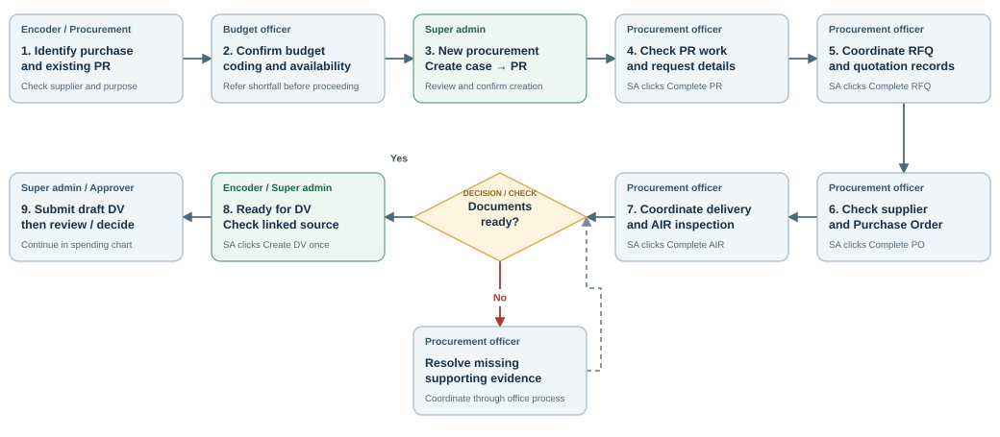

- Send the same procurement case reference, supplier details and supporting records to the Encoder / Super admin for DV preparation. Procurement alone does not grant the Disbursements page.
- The document-readiness diamond is an office check, not an implemented certification button. Stage changes track progress; they do not produce official PR, RFQ, PO or AIR documents or validate their evidence.

Editable Mermaid flowchart

```mermaid
flowchart LR
  p1["Encoder / Procurement<br/>1. Identify purchase<br/>and existing PR<br/>Check supplier and purpose"]:::check
  p2["Budget officer<br/>2. Confirm budget<br/>coding and availability<br/>Refer shortfall before proceeding"]:::check
  p3["Super admin<br/>3. New procurement<br/>Create case → PR<br/>Review and confirm creation"]:::live
  p4["Procurement officer<br/>4. Check PR work<br/>and request details<br/>SA clicks Complete PR"]:::check
  p5["Procurement officer<br/>5. Coordinate RFQ<br/>and quotation records<br/>SA clicks Complete RFQ"]:::check
  p6["Procurement officer<br/>6. Check supplier<br/>and Purchase Order<br/>SA clicks Complete PO"]:::check
  p7["Procurement officer<br/>7. Coordinate delivery<br/>and AIR inspection<br/>SA clicks Complete AIR"]:::check
  p8{"Decision / check<br/>Documents<br/>ready?<br/>Office check of evidence"}:::decision
  p9["Encoder / Super admin<br/>8. Ready for DV<br/>Check linked source<br/>SA clicks Create DV once"]:::live
  p10["Super admin / Approver<br/>9. Submit draft DV<br/>then review / decide<br/>Continue in spending chart"]:::check
  p11["Procurement officer<br/>Resolve missing<br/>supporting evidence<br/>Coordinate through office process"]:::check
  p1 --> p2
  p2 --> p3
  p3 --> p4
  p4 --> p5
  p5 --> p6
  p6 --> p7
  p7 --> p8
  p8 -->|"Yes"| p9
  p9 --> p10
  p8 -->|"No"| p11
  p11 -.-> p8
  classDef live fill:#ecf7f1,stroke:#6ea48c,color:#173147
  classDef check fill:#f0f5fa,stroke:#a7bdcb,color:#173147
  classDef decision fill:#fff5df,stroke:#d5ab4e,color:#173147
```

## Travel advances: settle the amount already paid.

Start only after a travel voucher is paid. Track the accountable person’s use of the advance, accepted expenses and returned cash without recording a second payment.

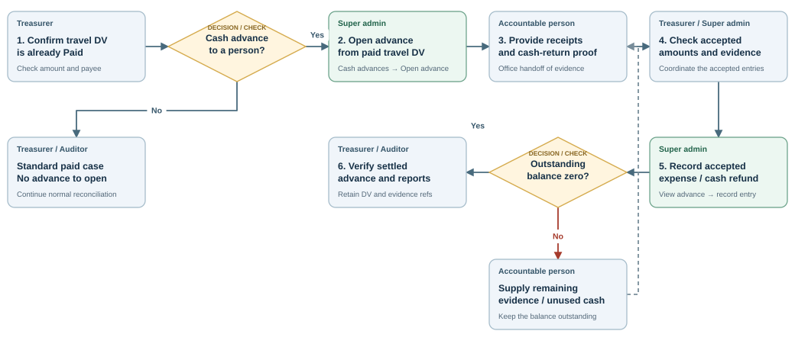

- Current live saves for opening an advance and recording liquidation/refund entries require Super admin access. Treasurer reviews the balance and evidence; the accountable person is an office participant, not an additional app role.
- Example: ₱8,900 advance − ₱8,000 accepted expenses − ₱900 refund = zero. Formal liquidation submission, due-date review and separate approval are not implemented; follow your established review process.

Editable Mermaid flowchart

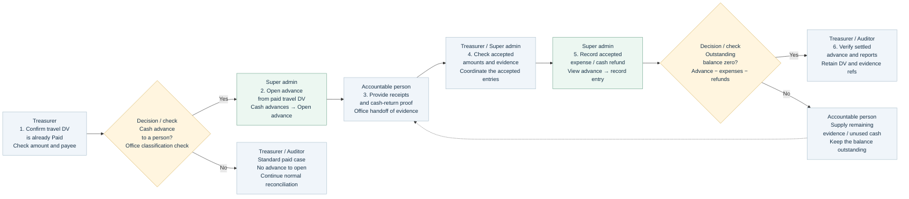

## Collections: from payer details to confirmed treasury matching.

Follow each receipt into its bank deposit or treasury remittance. Collector prepares and checks; Treasurer checks treasury evidence; Super admin records receipts and matching batches in the current live app.

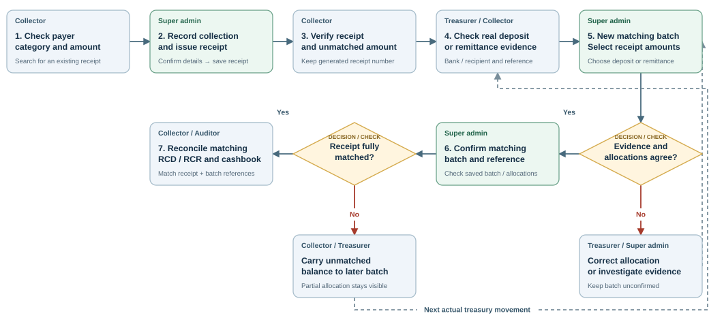

- A bank deposit moves previously collected cash into the bank; it is not additional revenue. A treasury remittance reduces cash and increases remitted collections. Allocations may be partial and cannot exceed unmatched amounts.
- To correct an issued receipt, coordinate with Super admin: an unallocated issued receipt can be voided and stays in history. A receipt already allocated to a batch cannot be voided through that action.

Editable Mermaid flowchart

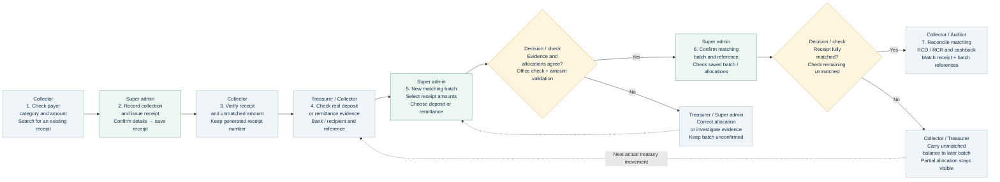

## Reports and oversight: trace records, investigate and follow up.

Review the spending and revenue branches together. Findings return to the responsible owner; staff access issues return to the Administrator or Super admin.

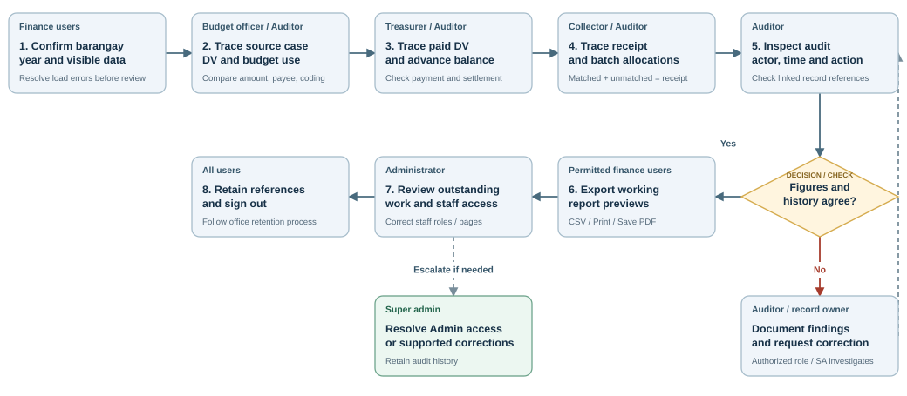

- Auditor reviews and reports findings; it does not edit records. The current audit page shows the latest loaded events. Reports depend on the account’s visible records; check scope before comparing totals.
- These are working report previews and system copies. Formal period lock/reopening, archived snapshots and several prescribed report templates remain pending. A review here does not complete an official period close.

Editable Mermaid flowchart

```mermaid
flowchart LR
  o1["Finance users<br/>1. Confirm barangay<br/>year and visible data<br/>Resolve load errors before review"]:::check
  o2["Budget officer / Auditor<br/>2. Trace source case<br/>DV and budget use<br/>Compare amount, payee, coding"]:::check
  o3["Treasurer / Auditor<br/>3. Trace paid DV<br/>and advance balance<br/>Check payment and settlement"]:::check
  o4["Collector / Auditor<br/>4. Trace receipt<br/>and batch allocations<br/>Matched + unmatched = receipt"]:::check
  o5["Auditor<br/>5. Inspect audit<br/>actor, time and action<br/>Check linked record references"]:::check
  o6{"Decision / check<br/>Figures and<br/>history agree?<br/>Review against source evidence"}:::decision
  o7["Permitted finance users<br/>6. Export working<br/>report previews<br/>CSV / Print / Save PDF"]:::check
  o8["Administrator<br/>7. Review outstanding<br/>work and staff access<br/>Correct staff roles / pages"]:::check
  o9["All users<br/>8. Retain references<br/>and sign out<br/>Follow office retention process"]:::check
  o10["Auditor / record owner<br/>Document findings<br/>and request correction<br/>Authorized role / SA investigates"]:::check
  o11["Super admin<br/>Resolve Admin access<br/>or supported corrections<br/>Retain audit history"]:::live
  o1 --> o2
  o2 --> o3
  o3 --> o4
  o4 --> o5
  o5 --> o6
  o6 -->|"Yes"| o7
  o7 --> o8
  o8 --> o9
  o6 -->|"No"| o10
  o10 -.-> o5
  o8 -.->|"Escalate if needed"| o11
  classDef live fill:#ecf7f1,stroke:#6ea48c,color:#173147
  classDef check fill:#f0f5fa,stroke:#a7bdcb,color:#173147
  classDef decision fill:#fff5df,stroke:#d5ab4e,color:#173147
```

